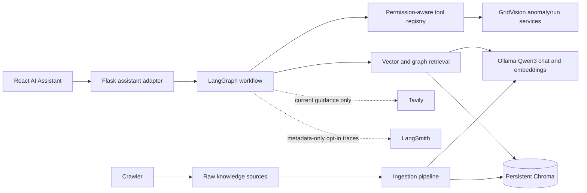

# GridVision Anomaly Intelligence Assistant

The assistant lives in `ai/anamoly/`. It reuses the Flask anomaly prediction
service and its `reports/anomaly_prediction/application_runs/<run_id>/` store;
it does not create a second detector or run database.

## Architecture



`crawler/` collects allow-listed public material. `ingestion/` extracts PDF/TXT/
Markdown/HTML/JSON, cleans text, chunks by page, and records source metadata.
`vector_store/` stores vectors in the one persistent Chroma collection. `graph/`
expands vector matches through shared anomaly, grid, and safety terms without
introducing a second graph database. `agents/` coordinates routing, retrieval,
recommendations, and Ollama responses. `tools/` is the only route to callable
GridVision operations. `memory/` persists threads only when a principal is
provided by backend middleware; without one, requests work but remain stateless.

## Models and dependencies

The default chat model is `qwen3:8b`; the default embedding model is
`qwen3-embedding:0.6b`. Both are configurable. Ollama must be running and
reachable from Flask. The Qwen3 chat model was already available when this
implementation was prepared. Pull the embedding model once if it is not present:

```sh
ollama pull qwen3-embedding:0.6b
```

Install the `anomaly-assistant` requirements group along with backend/model
serving dependencies. The Docker backend image installs that group too.

## Configuration and ingestion

Settings are environment variables; local secret files are a fallback and are
never printed in logs:

| Variable | Default |
|---|---|
| `GRIDVISION_ANOMALY_OLLAMA_BASE_URL` | `http://localhost:11434` |
| `GRIDVISION_ANOMALY_CHAT_MODEL` | `qwen3:8b` |
| `GRIDVISION_ANOMALY_EMBEDDING_MODEL` | `qwen3-embedding:0.6b` |
| `GRIDVISION_ANOMALY_VECTOR_DB_PATH` | `ai/anamoly/vector_store/storage/chroma/persistent_db/` |
| `GRIDVISION_ANOMALY_VECTOR_COLLECTION` | `gridvision_anomaly_knowledge` |
| `GRIDVISION_ANOMALY_KNOWLEDGE_BASE_PATH` | `ai/anamoly/knowledge_base/` |
| `GRIDVISION_ANOMALY_RAW_KNOWLEDGE_BASE_PATH` | `ai/anamoly/raw_knowledge_base/` |
| `GRIDVISION_ANOMALY_SECRETS_DIR` | `ai/anamoly/Key/` |
| `GRIDVISION_ANOMALY_DATE_LOCALE` | `en-IN` |
| `GRIDVISION_ANOMALY_LANGSMITH_TRACING` | `false` |

Tavily uses `TAVILY_API_KEY` or `Key/tavily/api.key`; LangSmith uses
`LANGSMITH_API_KEY` or `Key/langsmith/api.key`; remote HTTPS Ollama can use
`OLLAMA_API_KEY` or `Key/ollama/api.key`. Use environment variables or a
read-only secret mount in production. Never bake `Key/` into a container image.

Ingest the supplied web-scraped text and any manually added source documents
without changing the original files:

```sh
python -m ai.anamoly.ingestion.ingestion_pipeline
```

The existing manifest is read for URL, publisher, and collection metadata. CSV,
Parquet, and other customer time-series data are not supported ingestion types.
Unchanged sources are skipped; changed sources are upserted; document IDs are
stable by relative source path. An indexing failure is reported in the command's
JSON result and produces a non-zero exit status. To process one directory:

```sh
python -m ai.anamoly.ingestion.ingestion_pipeline \
  --source ai/anamoly/knowledge_base/raw \
  --manifest ai/anamoly/knowledge_base/manifest.jsonl
```

The vector collection is opened lazily, is never cleared during startup, and is
shared by the Flask service, graph retriever, and ingestion. To remove one indexed document, run
`python -m ai.anamoly.ingestion.ingestion_pipeline --delete-source raw/web_pages/example.txt`
(`--source-root` must match the root originally ingested); a changed source can
be re-indexed by running ingestion again. Use a new collection
name in `GRIDVISION_ANOMALY_VECTOR_COLLECTION` for a model/dimension migration.
Do not delete the previous collection until the replacement has been validated.

### Backup, restore, and Docker persistence

The persistent directory is ignored by Git and mounted to a host directory in
Compose. Stop the backend before taking a filesystem snapshot. Back up
`ai/anamoly/vector_store/storage/chroma/persistent_db/` as a directory; restore
the complete snapshot to the same configured path with backend stopped, then
start the service and verify collection count and a known retrieval query.
Keep an independent copy before model/Chroma migrations. Re-indexing is
incremental; changing embedding model dimensions requires a new collection and
full re-index rather than modifying the existing collection.

## Crawler

`crawler/sources.yaml` documents default authoritative domains and seed URLs.
The crawler also supports `GRIDVISION_ANOMALY_CRAWLER_ALLOWED_DOMAINS` and
`GRIDVISION_ANOMALY_CRAWLER_SEED_URLS` comma-separated overrides. It checks
robots.txt, waits at least 0.5 seconds between requests, follows only allow-listed
hosts, hashes content with SHA-256, and writes under
`raw_knowledge_base/crawled/` so manually provided source files are never
overwritten. It records source URL, domain, title, hash, and collection time in a
JSONL manifest. Run it explicitly with:

```sh
python -c "from ai.anamoly.crawler.scraper import KnowledgeCrawler; print(KnowledgeCrawler().crawl(max_pages=50))"
```

Review source terms, copyright, and permitted reuse before indexing scraped
material. Crawling is not run automatically during Flask startup.

## Tools and workflow

The registry exposes:

- Runs: `list_available_runs`, `find_run_by_date`, `get_run_details`,
  `get_run_status`.
- Anomalies/events: `query_anomalies`, `query_events`, `get_event_details`,
  `get_event_timeline`, `query_customer_impact`, `get_localization_metrics`.
- Analysis: `execute_anomaly_analysis`, `get_analysis_progress`,
  `get_analysis_configuration`.
- Knowledge/GraphRAG: `search_knowledge_base`, `retrieve_graph_context`.
- External research: `tavily_web_search`, `tavily_extract_content`.
- Exports: `export_anomaly_records`, `export_events`, `export_event_details`,
  `export_consolidated_report`.

Every tool has a JSON input schema, persona allowlist, authentication requirement,
side-effect/confirmation metadata, availability status, and execution log. There
is no general Python, SQL, shell, or filesystem tool. Analysis and exports require
an explicit user request. Tavily is used only for a current-guidance request or
when local references are insufficient; external results are cited separately
and never automatically indexed.

Recommendations distinguish observations from possible causes and include
investigation, mitigation, priority, responsible party, evidence, confidence, and
limitations. Residential prompts are not given instructions to perform hazardous
electrical work.

Historical anomaly answers come only from completed GridVision application runs
or an explicitly requested execution of the saved anomaly model bundle. The
execution path reuses `AnomalyPredictionService` and its inference pipeline to
score the requested data, classify anomaly windows, localize events, and persist
the results in `reports/anomaly_prediction/application_runs/<run_id>/`; it does
not retrain the model. A missing saved run prompts before executing unless the
user explicitly asks to run, predict, or analyze. Model predictions are never
substituted with web-search or LLM-generated estimates. A local dataset must be
available at `ANOMALY_DATASET_PATH` (default
`data/anomaly_prediction/synthetic_2019_normal.parquet`), and the saved bundle is
loaded from `ANOMALY_MODEL_PATH` (default
`models/anomaly_prediction/gridvision_anomaly_model.joblib`).

Each request records a pathway name (`GENERAL_RAG`, `SAVED_RUN_QUERY`,
`MODEL_INFERENCE`, `EVENT_ANALYSIS`, `RECTIFICATION_RAG`,
`EXTERNAL_WEB_SEARCH`, or `EXPORT`). Inference logs also include the model
name/version, run ID, dates, input row count, detected-window count,
localized-event count, and status; customer identifiers and prompts are not
included.

## Date guardrail and authorization

Only historical anomaly lookups and explicit analysis requests are checked
against the date bounds reported by the loaded anomaly dataset/model. Technical
explanations and knowledge-base questions do not require a date. Every analysis
request is limited to seven inclusive days. ISO dates and localized numeric
dates are accepted; the default `en-IN` locale interprets `03/04/2019` as
3 April 2019. Set `GRIDVISION_ANOMALY_DATE_LOCALE` to `en-US` for month-first
ambiguous numeric dates. Named-month dates and resolvable “today”/“yesterday”
references are also understood, then validated against the dataset range.
Missing historical dates do not trigger analysis. The assistant checks for
completed saved runs covering the full requested period first and asks before
starting a missing analysis. Per-run overrides do not change global
configuration. Full-population inference automatically splits customers into
bounded batches when necessary, then recombines anomaly windows before spatial
and temporal event localization so cross-batch events are still grouped.
Assistant replies summarize event and anomaly-type counts in natural language;
completed runs include a CSV download link when a single saved run covers the
requested data.

This demo has no authentication middleware. Assistant tools are callable without
a principal; GridVision tools remain limited to the Government persona, while
household and commercial queries still require customer IDs in their context.
Conversation memory is only persisted when backend middleware supplies a
principal. Knowledge search and public web research do not require an identity.

Memory keys conversations by a one-way hash of authenticated principal, thread ID,
and persona. Unauthenticated requests are stateless. LangSmith tracing is
disabled by default; when enabled, it sends only intent/persona/length/status and
citation-count metadata, not prompts, customer IDs, or tool record payloads.

## Flask and React

The existing `/api/v1/assistant/chat` contract remains available. The React
assistant uses `/api/v1/assistant/chat/stream` (SSE) to receive Ollama output
tokens, then displays citations, run references, and download links. Tool
descriptions are available from `/api/v1/assistant/tools`. Downloads reuse the
existing anomaly-run artifact endpoint and storage.

### Run a demo query

For Government-tab testing without an identity provider, start the Flask backend
from the repository root:

```sh
./.venv/bin/python backend/run.py
```

In another terminal, open the React app with `npm run dev`, or post a query
directly to the backend:

```sh
curl -X POST http://127.0.0.1:5000/api/v1/assistant/chat \
  -H 'Content-Type: application/json' \
  -d '{"prompt":"What does a flatline anomaly mean in an energy time series?","persona":"household"}'
```

The 15 ready-to-try prompts and notes on dates, authentication, and run IDs are
in [`demo_queries.txt`](../demo_queries.txt). Replace `YYYY-MM-DD` there with a
date within the anomaly dataset's available range. Ensure Ollama is running and
the configured chat model is pulled before asking the assistant. Knowledge-base
queries also need the existing Chroma index; if it is empty, run the ingestion
command above once.

## Evaluation and tests

The offline grounding evaluator reports citation coverage and reference presence.
Focused tests under `tests/` cover tool input/permission checks, dataset-derived
date bounds, relative-date handling, document metadata, incremental indexing, and
source replacement. The backend's existing insight response behavior remains
available for non-anomaly prompts.

Example queries:

- “Show today's anomalies.” → explains that the dataset is historical and asks
  for a supported 2019 date.
- “What anomalies were found on 2019-05-12?” → checks completed saved runs first.
- “Run anomaly analysis for 2019-05-12.” → requests a new one-day run only because
  the user explicitly requested it.
- “Explain the safety steps for investigating a flatline event.” → searches local
  sources and cites document title/page; it does not claim a probable cause is a
  confirmed fault.
- “Export events from run ID `<32-hex-run-id>` as CSV.” → creates a report from
  stored run records and returns the existing secure-format download route.
