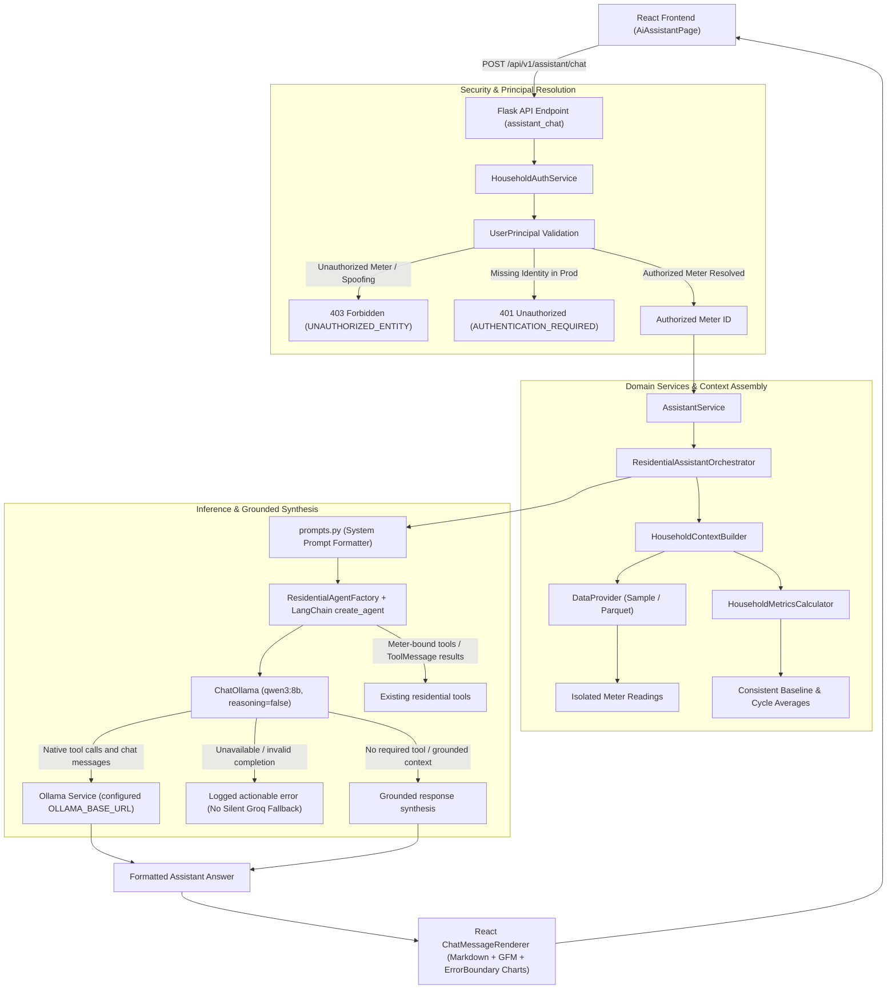
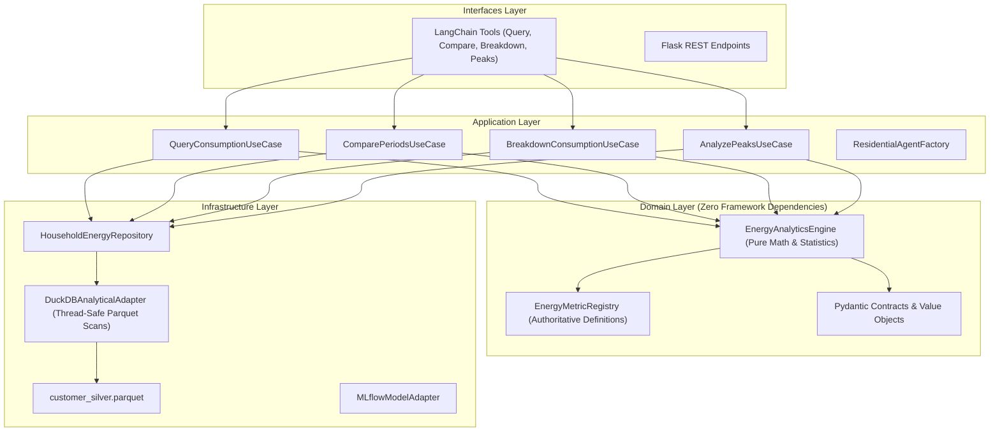

# GridVision — Residential Energy Assistant (Milestone 1 Architecture & Operations)

## 1. System Overview & Architecture

The **GridVision Residential Energy Assistant** is an isolated, conversational AI subsystem designed to explain electricity telemetry, billing projections, diurnal consumption patterns, and tariff calculations for residential households.

### End-to-End Architecture Flow



---

## 2. Authentication & Household Isolation

### Zero Trust on Client Identity
The assistant enforces server-side identity verification:
1. **Never Trust Client-Supplied IDs:** A client-supplied `entity_id` is never accepted as authorization.
2. **Principal Resolution (`HouseholdAuthService`):**
   - **Production Mode (`DEVELOPMENT_AUTH_ENABLED=False`):** Derives identity from trusted server-side session or verified Bearer token. Requests without valid identity fail closed (`401 Unauthorized`).
   - **Development Mode (`DEVELOPMENT_AUTH_ENABLED=True`):** Validates requested meter against server-configured `DEV_USER_METER_MAPPING`. If an unauthorized meter ID is sent, access is denied (`403 Forbidden`).
3. **No Hardcoded Fallback:** Missing or blank meter IDs fail closed; the system never silently defaults to Customer 1000.

---

## 3. Data Sources & Provenance

### Datasets
- **Current Source:** Retrospective benchmark telemetry records (`SampleDataProvider`).
- **Data Vintage:** December 2018 (`2018-12-19`), aligned with 2018 smart meter telemetry.
- **Data Status:** Stamped in context as `recorded_historical_cycle`. Directive 4 instructs the LLM never to claim live streaming feeds for historical logs.

### Numerical Definitions & Grounding
To prevent discrepancies (e.g. METER-1003 snapshot), metrics are derived mathematically via `HouseholdMetricsCalculator`:

| Metric | Formula / Definition | Example (`METER-1003`) |
| :--- | :--- | :--- |
| **`actualCycleKwhSoFar`** | Sum of actual energy recorded up to Day 19. | `598.0 kWh` |
| **`cycleDailyAverageKwh`** | `actualCycleKwhSoFar / elapsedDays` | `598.0 / 19 = 31.47 kWh/day` |
| **`currentDailyUsageKwh`** | Most recent 24h cycle consumption. | `31.5 kWh/day` |
| **`baselineDailyAverageKwh`** | 30-day baseline reference average. | `32.4 kWh/day` |
| **`dailyChangeVs30dBaselinePct`** | `((currentDaily - baselineDailyAvg) / baselineDailyAvg) × 100` | `-2.8%` |
| **`prev7DaysAvgKwh`** | Trailing 7-day average daily usage. | `33.2 kWh/day` |
| **`dailyChangeVs7dAveragePct`** | `((currentDaily - prev7DaysAvg) / prev7DaysAvg) × 100` | `-5.1%` |
| **`estimatedMonthEndKwh`** | `actualCycleKwhSoFar + predictedRemainingKwh` | `598.0 + 272.5 = 870.5 kWh` |
| **`estimatedMonthEndBillInr`** | `estimatedMonthEndKwh × tariffRate` | `870.5 × ₹10.00 = ₹8,705.00` |

---

## 4. Configuration & Environment Variables

All settings are centralized in `app/config.py` and configurable via `.env`:

| Variable | Default Value | Description |
| :--- | :--- | :--- |
| `OLLAMA_BASE_URL` | `http://localhost:11434` | Ollama server URL; Docker Compose defaults to `http://host.docker.internal:11434` for host-installed Ollama. |
| `OLLAMA_MODEL` | `qwen3:8b` | Model tag pulled into Ollama. |
| `ASSISTANT_TEMPERATURE` | `0.2` | Sampling temperature for analytical determinism. |
| `ASSISTANT_MAX_TOKENS` | `800` | Maximum token limit for completions. |
| `ASSISTANT_TIMEOUT_SECONDS` | `60.0` | Ollama request timeout. |
| `ASSISTANT_MAX_RETRIES` | `0` | Number of configured retries for assistant requests. |
| `CUSTOMER_TARIFF_INR_PER_KWH` | `10.0` | Prototype billing tariff rate (₹/kWh). |
| `DEVELOPMENT_AUTH_ENABLED` | `true` (dev) / `false` (prod) | Controls whether development principal resolution is allowed. |
| `AUTHORIZED_RESIDENTIAL_METERS` | `METER-1000,METER-1001,METER-1002,METER-1003` | Server-authorized residential smart meters pool. |
| `GROQ_API_KEY` / `GROQ_MODEL` | Inactive | Retained for manual switch-back; not used by the active Ollama runtime. |

---

## 5. API Contracts

### Chat Request (`POST /api/v1/assistant/chat`)
```json
{
  "prompt": "Explain my estimated bill for this month.",
  "persona": "household",
  "entity_id": "METER-1000",
  "history": [
    { "role": "user", "content": "Hello" },
    { "role": "assistant", "content": "Hello Resident-1000! How can I help you?" }
  ]
}
```

### Successful Response (`200 OK`)
```json
{
  "success": true,
  "data": {
    "answer": "### Verified Billing Summary for **METER-1000**...",
    "persona": "household",
    "entityId": "METER-1000",
    "customerName": "Resident-1000",
    "status": "success",
    "isLlmGenerated": true
  }
}
```

### Unauthorized Error Response (`403 Forbidden`)
```json
{
  "success": false,
  "error": {
    "code": "UNAUTHORIZED_ENTITY",
    "message": "Access denied: You are not authorized to view smart meter 'METER-9999'."
  }
}
```

---

## 6. How to Run & Test

### Run Backend
```powershell
cd d:\Projects\gridvision-final\backend
python run.py
```

### Run Frontend
```powershell
cd d:\Projects\gridvision-final\frontend
npm run dev
```

### Execute Test Suites
```powershell
cd d:\Projects\gridvision-final
$env:PYTHONPATH="backend"
python -m pytest ai/residential/tests/backend/test_residential_assistant.py ai/residential/tests/backend/test_historical_analytics.py
```

### Execute Historical Snapshot Backfill & Refresh
```powershell
cd d:\Projects\gridvision-final
$env:PYTHONPATH="backend"
# Backfill all authorized meters:
python -m app.services.assistant.historical.backfill

# Or backfill a single meter:
python -m app.services.assistant.historical.backfill --meter METER-1000
```

### Execute Frontend Build & Lint Check
```powershell
cd d:\Projects\gridvision-final\frontend
npm run build
```

---

## 7. Historical Household Analytics & Snapshot System

### Architecture Pipeline

```mermaid
flowchart LR
    SilverParquet["Silver Parquet (customer_silver.parquet)"] --> Reader["HistoricalObservationReader"]
    Reader --> Analytics["HistoricalAnalyticsService (Pure Math)"]
    Analytics --> Builder["HistoricalSnapshotBuilder"]
    Builder --> Repo["HistoricalSnapshotRepository (Sidecar JSON)"]
    Repo --> ContextBuilder["HouseholdContextBuilder (contextSchemaVersion 2.0)"]
    ContextBuilder --> Prompts["prompts.py (Historical Directives)"]
    Prompts --> LLM["OllamaLLMAdapter (Local Ollama)"]
```


### Context Schema Contract (`contextSchemaVersion 2.0`)
```json
{
  "contextSchemaVersion": "2.0",
  "contextCapabilities": {
    "recentAnalyticsAvailable": true,
    "historicalProfileAvailable": true,
    "historicalYearlyTrendsAvailable": true,
    "historicalMonthlyTimelineAvailable": true,
    "historicalSeasonalityAvailable": true,
    "detailedHistoricalQueriesAvailable": false
  },
  "householdIdentity": { ... },
  "dataProvenance": { ... },
  "billingCycleStatus": { ... },
  "recentConsumptionMetrics": { ... },
  "historical30DOverview": { ... },
  "historicalProfile": {
    "meterId": "METER-1000",
    "coverage": {
      "startDate": "2018-01-01",
      "endDate": "2018-12-31",
      "dataSource": "customer_silver_hourly",
      "dataStatus": "recorded_historical",
      "observationGranularity": "hourly_interval",
      "validObservationCount": 8395,
      "expectedObservationCount": 8760,
      "completenessPct": 95.8,
      "missingPeriods": []
    },
    "allTimeSummary": {
      "totalConsumptionKwh": 5496.91,
      "averageDailyConsumptionKwh": 15.06,
      "medianDailyConsumptionKwh": 12.7,
      "p90DailyConsumptionKwh": 22.82,
      "highestConsumptionDay": { "date": "2018-07-07", "consumptionKwh": 44.37 },
      "lowestConsumptionDay": { "date": "2018-04-16", "consumptionKwh": 8.81 }
    },
    "yearlyTrends": [ ... ],
    "monthlyTimeline": [ ... ],
    "seasonality": [ ... ],
    "historicalExtremes": { ... },
    "longTermBehaviour": { ... },
    "snapshotMetadata": {
      "generatedAt": "2026-11-01T09:06:07+00:00",
      "schemaVersion": "1.0",
      "calculationVersion": "1.0",
      "sourceDataVersion": "20261028T203529-dff289b7"
    }
  }
}
```

---

---

## 8. Clean Architecture & Unified Energy Analytics Engine

With the introduction of the **Energy Analytics Engine** and **LangChain AI Orchestration**, GridVision follows a Clean Architecture design where domain calculations, data access, and AI orchestration are decoupled:



### Layer Responsibilities
1. **Domain Layer (`app/domain/energy/`):**
   - Independent of Flask, LangChain, Groq, DuckDB, MLflow, or Pandas storage formats.
   - `EnergyMetricRegistry`: Single authoritative definition for metric units, valid observation counts, and calculation methodologies.
   - `EnergyAnalyticsEngine`: Deterministic algorithms for temporal aggregation (hourly, daily, weekly, monthly, yearly), distribution statistics (mean, median, P10, P90, min, max, std, CV), period comparison with normalized daily rates, categorical breakdowns (hour-of-day, day-of-week, monthly), and peak rankings.
2. **Infrastructure Layer (`app/infrastructure/`):**
   - `DuckDBAnalyticalAdapter`: Thread-safe, connection-isolated DuckDB engine that queries local Parquet datasets using parameterized SQL (`?` placeholders) and column allowlists.
   - `HouseholdEnergyRepository`: Implements `BaseHouseholdEnergyRepository`, enforcing single-meter isolation and resolving canonical meter IDs.
3. **Application Layer (`app/application/energy_analytics/`):**
   - Use cases coordinate repository data loading with domain calculations and wrap results in typed `AnalyticsToolResponse` contracts.
4. **Interfaces & AI Orchestration Layer (`app/interfaces/assistant/tools/` & `app/services/assistant/`):**
   - `create_residential_tools(authorized_meter_id)`: Registers the 4 analytics tools with the authorized meter ID hard-bound into the tool closure. The LLM cannot specify or tamper with meter access.
   - `IntelligentRouter` selects a tool scope and recommended tools for each turn. Agents are cached by the current grounded prompt and selected tool set so customer/session context cannot go stale.
   - `ResidentialAgentFactory` uses LangChain's existing `create_agent` loop with `ChatOllama` for tool-driven tasks. Native Ollama tool-call IDs and `ToolMessage` results preserve the standard model → tool → model sequence; `reasoning=False` disables Qwen3 thinking output so user-visible text is returned as message content.
   - General electrical knowledge and standards questions are routed directly through the verified document retriever, with citations, rather than relying on Qwen to decide whether to call the RAG tool. Household telemetry, current billing, forecasts, and explicit planning/calculation requests continue to use their dedicated context or domain tools.
   - Document answers search the full indexed corpus, retain up to two high-ranking passages per source document, and cite all sources actually supplied to the language model. This keeps every indexed document eligible while avoiding irrelevant citations and unbounded passage counts.
   - Undated current-bill questions use the latest recorded billing context without exposing prediction tools. Explicit month/year bill queries execute a date-bounded historical telemetry lookup before the LLM writes its final answer. Historical usage synthesis uses the verified result and tariff in a compact prompt to keep answers concise and bill calculations grounded.

### LangChain Analytics Tools

| Tool Name | Purpose | Arguments | Underlying Engine Primitive |
| :--- | :--- | :--- | :--- |
| `query_consumption_history` | Retrieve consumption for date range and granularity. | `start_date`, `end_date`, `granularity` | `EnergyAnalyticsEngine.aggregate_intervals` |
| `compare_consumption_periods` | Compare usage between two custom periods. | `start_date_a`, `end_date_a`, `start_date_b`, `end_date_b`, `metric` | `EnergyAnalyticsEngine.compare_periods` |
| `get_consumption_breakdown` | Analyze consumption distribution. | `start_date`, `end_date`, `dimension` | `EnergyAnalyticsEngine.breakdown_consumption` |
| `get_peak_consumption_periods` | Identify top peak or trough consumption intervals. | `start_date`, `end_date`, `granularity`, `top_n`, `ranking_direction` | `EnergyAnalyticsEngine.get_peak_periods` |

---

## 9. Known Limitations & Roadmap

1. **Detailed Interval Queries:** Fully operational via the 4 LangChain tools and DuckDB repository over `customer_silver.parquet` for any custom date range.
2. **Multi-Year Telemetry Coverage:** The underlying `customer_silver.parquet` contains 1 complete calendar year (2018). Multi-year seasonality (`isEstablishedPattern`) and YoY comparisons are supported by the calculation engine and tested via synthetic fixtures, but will show `isEstablishedPattern: false` and `yearOverYearChangePct: null` until multi-year silver datasets are ingested.
3. **Production Token Authentication:** Production deployments require binding `HouseholdAuthService.resolve_principal` to the enterprise identity provider's JWT public key.
4. **Future Extension Points:** The Clean Architecture boundaries allow seamless introduction of LangGraph custom workflows, vector search/RAG, Docling/OCR parsing, and specialized commercial/government personas without modifying the domain energy engine.
