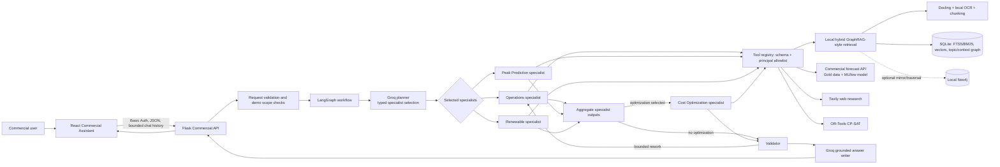

# GridVision Commercial AI Architecture

## Purpose and scope

This document describes the Commercial AI assistant implemented in GridVision. It is intended to support an architecture presentation and to distinguish the running design from optional integrations and future production work.

The Commercial assistant is an evidence-oriented analysis workflow for operational questions, energy forecasts, renewable scenarios, and schedule optimization. Its main parts are:

1. A React chat page and authenticated Flask API.
2. A bounded LangGraph workflow with a Groq planner, specialist nodes, validation, and grounded answer generation.
3. A permission-aware registry that mediates all specialist tool calls.
4. A local hybrid retrieval system for operational documents, plus adapters for forecasting, renewable research, and optimization.

The current demo is scoped to the synthetic `automotive-parts-demo` corpus. It is not a production multi-tenant factory deployment, and it does not control equipment.

## Architecture at a glance

The workflow is a controlled orchestration system. The LLM proposes which specialists to run and writes the final prose, while application code validates inputs, authorizes tools, executes calculations, checks evidence, and determines whether the result is complete.

## Request-to-answer flow

1. **The user asks a question.** The Commercial page sends the current goal and a small recent conversation history. The UI keeps that history in page memory; it is not persisted as server-side long-term memory.
2. **The API validates the request.** Pydantic models reject malformed or extra fields. The endpoint enforces the demo factory scope and rejects a building ID for this synthetic factory. The current endpoint uses a local demo Basic Auth gate.
3. **The workflow validates and routes.** A LangGraph `StateGraph` validates the request, checks for a greeting, then calls the supervisor/planner. Groq returns a strict JSON-schema selection from a fixed set of specialist names. The application maps each name to a fixed tool allowlist. If the LLM provider is unavailable, the request is reported as a planning failure; it does not silently claim a successful mock result.
4. **Selected specialists run.** Independent specialist nodes can be scheduled by LangGraph. Each receives a bounded assignment and calls only its registered tool through the registry. Cost optimization is run after specialist aggregation because it requires a structured schedule payload.
5. **Results are checked.** The validator checks status, evidence references, missing data, conflicts, and retryable failures. A limited rework round can rerun failed specialists. Graph steps, tool calls, and rework attempts have configured limits.
6. **The answer is composed.** For completed results, Groq receives bounded tool output and deduplicated source excerpts. It must use only supplied results, preserve deterministic values, and cite supplied source markers. Citation IDs are checked against the supplied references. The response includes status, findings, assumptions, conflicts, evidence, and execution metadata.
7. **The user sees a concise response.** The UI shows the answer, expandable document sources, web citations where relevant, and schedule proposal details. It does not need to expose internal agent payloads as the user-facing answer.

## Multi-agent workflow and LangGraph

The workflow is built in `ai/commercial/graph.py` using LangGraph's `StateGraph`. A typed shared state carries the request, specialist assignments, tool observations, evidence references, assumptions, conflicts, validation status, counters, and final response.

### Supervisor and specialist roles

| Role | Responsibility | Registered capability |
|---|---|---|
| Supervisor / Planner | Select one or more relevant specialists from the fixed capability set | No data tool |
| Operations | Find evidence in the configured operations corpus | `operational_context_read` |
| Peak Prediction | Retrieve an existing trained commercial building forecast | `commercial_buildings_list`, `peak_forecast` |
| Renewable | Research and calculate explicitly parameterized renewable scenarios | `renewable_scenario_read` |
| Cost Optimization | Find a feasible low-cost schedule from supplied structured inputs | `cost_optimizer` |
| Validator | Check completeness, evidence, errors, and retry eligibility | No external tool |
| Finalizer | Produce the grounded answer and structured response | Groq answer generation; no data tool |

The Groq planner returns typed names only; it cannot pass arbitrary Python, SQL, filesystem paths, or tool arguments for execution. Specialist assignments carry an allowed-tool tuple, and the registry independently checks the caller principal and input schema.

### Skills

The four Markdown skill files under `ai/commercial/skills/` describe each specialist's purpose, when it should be selected, and its limits. `ai/commercial/agents/skills.py` loads these files into the supervisor prompt. They are **routing and capability guidance**, not executable plugins and not authorization rules. The registered tool allowlist remains authoritative even if a prompt or model requests an unsupported action.

This separation makes the system easier to explain and maintain: business capability descriptions can be updated independently from typed tool contracts and application permission checks.

### Why use a graph workflow?

- **Conditional routing:** a question about operations does not need to call the optimizer or forecast service.
- **Parallel specialists:** independent evidence gathering can happen in the same workflow run.
- **Explicit state:** intermediate assignments, evidence, errors, and counters can be inspected and validated.
- **Bounded recovery:** the workflow has limits on graph steps, tool calls, and rework, which reduces runaway loops and gives predictable failure states.
- **Clear control points:** aggregation, validation, optional optimization, and answer writing are explicit nodes rather than hidden inside one long prompt.

## Tool authorization and data contracts

`ai/commercial/tools/registry.py` is the canonical tool registration point. Every tool has a stable name and description, a Pydantic input model, a provider handler, an allowlist of trusted principals, and an optional MCP exposure flag. The registry rejects unknown tools, unauthorized principals, extra or invalid fields, oversized JSON inputs/outputs, and malformed observations.

The LLM is therefore a planner and answer writer, not the security boundary. Trust decisions and tool dispatch stay in application code. Retrieved documents are treated as untrusted evidence; document text cannot grant access or override system policy.

## Operations RAG and GraphRAG-style retrieval

### What “GraphRAG” means here

The Commercial Operations retriever is best described as **hybrid, graph-enhanced RAG** or **GraphRAG-style retrieval**. It combines lexical search, vector similarity, topic links, and a typed context graph. It is not a full semantic knowledge-graph extraction pipeline and does not implement LLM-generated community summaries. Entity and relationship extraction is deterministic and rule/label based, and each extracted item retains its source provenance and confidence.

### Ingestion pipeline

1. **Source validation:** documents must be under configured allowed roots, use supported formats, and comply with byte, page, character, timeout, and encryption bounds. Content hashes allow unchanged files to be skipped.
2. **Text extraction:** Docling handles layout-aware PDF and Office extraction. Markdown, TXT, HTML, and CSV inputs are also supported. PDF page text is checked first; OCR is used only where selectable text is absent.
3. **OCR:** local Tesseract with Pillow and `pypdfium2` handles scanned PDF pages and uploaded image formats. OCR page count, render scale, pixel count, and timeout are bounded. OCR text receives lower extraction confidence than directly extracted text. If the local OCR engine is missing or fails, pages are marked unavailable; text is not fabricated and no remote OCR fallback is silently used.
4. **Chunking and provenance:** text is split by page, heading, and bounded passage size. Each chunk retains source ID, document SHA-256, page, section, extraction method, and synthetic-data status. Chunk IDs are stable for the same source content and location.
5. **Indexing:** chunks and metadata are persisted locally in SQLite. The default index is `data/commercial/rag/index.sqlite3`.

### Retrieval pipeline

1. A deterministic query planner maps the question to supported handbook topics and builds a focused search query. Broad or underspecified questions can return `QUERY_NEEDS_CLARIFICATION`; factory-specific questions require real, non-demonstration records.
2. Four candidate lists are generated:
   - **Lexical retrieval:** SQLite FTS5 with BM25 ranking.
   - **Vector retrieval:** local feature-hash vectors by default, compared with cosine similarity. FastEmbed with a locally cached model is an optional adapter; it is not the default and does not download from the network during search.
   - **Topic graph retrieval:** topic-to-passage links retrieve passages associated with mapped subject areas.
   - **Context graph retrieval:** explicit asset IDs can retrieve graph-related passages, including bounded adjacent relations such as `DEPENDS_ON`, `FEEDS`, and `RESTRICTED_BY`.
3. **Reciprocal Rank Fusion (RRF)** combines the ranked candidate lists so one retrieval channel does not need to use the same score scale as another.
4. Results are filtered for duplicate content and scope. The demo corpus is labeled synthetic and is not treated as actual factory measurements. Returned passages include source, page/section, content hash, extraction confidence, and a synthetic flag.
5. The Operations specialist forwards those references through the workflow. The grounded-answer pass can cite only the evidence it received.

### Context graph schema and graph storage

The typed graph has entities such as `Factory`, `Department`, `ProductionLine`, `Machine`, `Operation`, `EnergySource`, `Constraint`, `MaintenanceProcedure`, `ProductionTarget`, `Guideline`, `SourceDocument`, and `Passage`. Relationships include `CONTAINS`, `PERFORMS`, `DEPENDS_ON`, `CONSUMES`, `PRODUCES`, `REQUIRES`, `RESTRICTED_BY`, `MAINTAINED_BY`, `FEEDS`, and `SUPPORTED_BY`.

Extraction is conservative: it recognizes labeled records, equipment-register rows, named references, and explicit directive-style constraints. Entity and relationship records retain the supporting chunk, source, page, section, and extraction confidence. SQLite is the default store for chunks, vectors, full-text search, and graph tables. A local Neo4j mirror and bounded graph traversal are optional (`COMMERCIAL_RAG_GRAPH_BACKEND=neo4j`); Neo4j is not required for the default demo.

### Why hybrid and graph-enhanced retrieval?

- BM25 works well for exact terms, machine identifiers, and technical vocabulary.
- Vector search can find related wording that does not exactly match the user's phrasing.
- Topic links give stable subject-area matches for the curated handbook.
- Context edges help answer questions that depend on relationships between an asset and its constraints or dependencies.
- Provenance and score fusion provide multiple paths to candidate evidence while keeping the final answer auditable.
- Local indexing keeps factory documents and embeddings on the local deployment by default.

The default feature-hash vectors are lexical features, not pretrained semantic embeddings. That is a deliberate offline default, not a claim of deep semantic understanding.

## OCR and document understanding

OCR means **Optical Character Recognition**: turning pixels from a scanned page or image into searchable text. GridVision uses local OCR after ordinary text extraction has been attempted. Docling provides layout-aware parsing for document structure; Tesseract provides OCR for image-only content. These are complementary steps: Docling is the document conversion layer, while OCR recovers text from page images that have no selectable text.

OCR errors are possible, so OCR-derived references carry reduced confidence and retain the page location and extraction method. The uploaded image and scanned-page paths share the local OCR dependencies. The source PDF supplied for the demo is image-only; without working local OCR, it remains unavailable to retrieval rather than becoming invented content.

## Tavily: external web search

Tavily is used in two distinct, bounded ways:

1. **Renewable specialist research:** after required sizing inputs are parsed, the renewable tool searches for relevant solar, wind, or battery guidance and returns cited web sources. The numerical scenario is calculated deterministically from the user's explicit inputs and documented assumptions. If Tavily is unavailable, the tool can still return a clearly labeled input-based estimate when it has enough inputs; missing required inputs remain unavailable.
2. **Optional Operations fallback:** when the local Operations RAG returns `DATA_NOT_AVAILABLE`, the chat offers the user a web-search choice. The general search endpoint is called only after the user selects **Search web sources**. Tavily's returned answer and citations are presented separately from local document evidence. This prevents outside web content from being silently mixed into site-specific records.

Tavily is not the local RAG index and is not called automatically as a fallback for every Operations query. API credentials are read from configuration/key files and mounted read-only in Compose; they are not embedded in the image or logged.

## Other major technologies

| Technology | Use in Commercial AI | Default or optional? |
|---|---|---|
| React + TypeScript | Commercial chat UI, upload list, source citations, and schedule proposal display | UI implementation |
| Flask | Authenticated workflow, upload/list/delete, session, web-search, and approval API endpoints | Core API |
| Pydantic | Request, workflow state, evidence, tool input/output, and optimizer validation | Core contracts |
| LangGraph | Typed state graph, conditional routing, specialist orchestration, bounded rework, and trace points | Core workflow |
| Groq SDK | Strict JSON-schema specialist selection and grounded answer generation | Default LLM provider from environment-backed settings |
| SQLite + FTS5 | Persistent local document/chunk index, BM25 search, vectors, and graph tables | Default RAG storage |
| Local feature hashing | Deterministic offline lexical vector representation | Default vectorizer |
| FastEmbed / ONNX | Local pretrained vector embeddings | Optional, model must already be cached |
| Neo4j | Optional graph mirror and bounded traversal | Optional; SQLite remains default |
| Docling | Layout-aware PDF and Office-document conversion | Document ingestion dependency |
| Tesseract + Pillow + pypdfium2 | Local OCR of image uploads and scanned PDF pages | Optional dependencies/runtime executable; OCR enabled by settings when installed |
| Tavily | Cited renewable research and explicitly selected web fallback | External service, requires a key |
| OR-Tools CP-SAT | Deterministic constrained scheduling and cost minimization | Optional solver dependency |
| MLflow | Registered Commercial forecast model and alias used by the existing model-serving API | Existing forecast integration |
| MCP (stdio) | Optional local tool interface for MCP clients | Optional server; read-oriented tool contracts only |
| LangSmith | Optional LangGraph tracing/evaluation integration | Optional; no effect on authorization |

### Peak Prediction integration

Peak Prediction calls the existing Commercial forecast API rather than asking an LLM to invent a forecast. The API uses a configured Commercial Gold dataset and registered MLflow model alias. The adapter validates the returned building ID, units, timestamps, period, and provenance. Results are described as historical Gold-data replays, not live telemetry. The assistant does not map the demo `factory_id` to a forecast `building_id`; a valid dataset building identifier is required.

### Cost Optimization integration

The optimizer uses OR-Tools CP-SAT, a constraint programming solver. It accepts a validated, explicit schedule: horizon, hourly tariffs, jobs, machines, durations, windows, dependencies, and optional maintenance, demand, renewable, and battery constraints. It returns a feasible or optimal schedule and calculates cost from those inputs. Savings are reported only when a complete baseline schedule is supplied. Prose alone does not create missing job or tariff data.

When a feasible proposal is returned, the backend creates a proposal record with an identifier/hash and requires an approval decision to be recorded. This is an audit/approval workflow only. The system has no equipment-control action and does not execute the schedule.

### MCP server

The optional Model Context Protocol server in `ai/commercial/mcp_server.py` uses local stdio transport and opens no network listener. It exposes only registered, read-oriented tool contracts. It does not expose raw database access, arbitrary file paths, document ingestion, secrets, or equipment commands. MCP authorization still passes through the registry.

## Guardrails, limitations, and observability

- **Evidence first:** document-backed claims retain citations; factory values, costs, and savings are not fabricated when tools return unavailable.
- **Prompt-injection boundary:** retrieved document and user text are input data, not policy or authorization instructions.
- **Typed capabilities:** the LLM chooses among fixed specialist names; the registry controls actual tool use.
- **Bounded execution:** configurable limits constrain graph steps, tool calls, request sizes, document sizes/pages, OCR pages/time, and rework.
- **Data provenance:** document excerpts retain source/page/section/hash, extraction confidence, and synthetic status; forecast observations retain model/dataset provenance.
- **Privacy-conscious logs:** workflow logs capture correlation IDs, node/tool status, durations, and bounded counters; prompts, excerpts, tool arguments, and credentials are omitted.
- **Demo identity:** current Basic Auth is a local demo gate, not production identity, role management, or tenant isolation. Compose should remain loopback-bound unless separately secured.
- **No control plane:** schedule approval records do not actuate equipment. A production implementation would need vendor integration, roles, safety interlocks, and commissioning.
- **Synthetic data:** the included automotive-parts corpus is demonstration content, not measured factory records.
- **Optional services:** Neo4j, FastEmbed, Tavily, OR-Tools, MCP, and LangSmith have separate configuration/dependency requirements. The core local RAG index uses SQLite and feature-hash vectors.

Structured node and tool logs support diagnosis. LangSmith tracing can be enabled for graph-level traces when configured. The evaluation harness compares the multi-agent graph with a sequential baseline using annotated cases; it requires human-labeled expected outcomes and does not claim autonomous evaluation truth.

## Why this architecture was chosen

The Commercial domain mixes different kinds of work: retrieving operating procedures, reading model forecasts, searching current external information, and solving numeric schedules. A single free-form LLM call would blur those distinctions and make it difficult to tell where a number came from. The selected architecture assigns each kind of work to the appropriate component:

- **LLM for language tasks:** understand user intent, select relevant specialists, and turn validated outputs into readable prose.
- **Retrieval for documentary evidence:** find passages and preserve their source location.
- **Existing MLflow service for forecasts:** reuse the trained model and dataset path instead of recreating predictive behavior in chat.
- **Deterministic solver for schedules:** enforce explicit constraints and compute costs with a solver rather than relying on language-model arithmetic.
- **Tavily for external research:** fetch cited outside material only in the renewable workflow or after explicit consent for the Operations fallback.
- **Application code for policy:** validate requests, enforce scope, authorize tools, bound work, and decide whether results are complete.

This division improves explainability, testing, and failure handling. It also allows the system to say “data unavailable” honestly, instead of filling gaps with plausible but unsupported factory facts.

## Presentation summary

> GridVision Commercial AI is a bounded, evidence-grounded multi-agent workflow. LangGraph coordinates specialist agents; Groq handles routing and final language; a permission-aware Pydantic tool registry controls capabilities; and each specialist uses the right engine—hybrid graph-enhanced RAG for documents, the existing MLflow-backed service for forecasts, Tavily for cited research, and OR-Tools CP-SAT for schedules. Sources, assumptions, and limits remain visible, and the current demo proposes schedules but never controls equipment.

## Code map

| Concern | Main files |
|---|---|
| Workflow composition and bounds | `ai/commercial/graph.py`, `ai/commercial/config/settings.py`, `ai/commercial/schemas/state.py` |
| Groq planning and answer generation | `ai/commercial/agents/planner.py`, `ai/commercial/prompts/supervisor.py` |
| Skills and specialist nodes | `ai/commercial/agents/skills.py`, `ai/commercial/skills/`, `ai/commercial/agents/` |
| Authorization and tools | `ai/commercial/tools/registry.py`, `ai/commercial/tools/document_rag_tools.py` |
| Document extraction and chunking | `ai/commercial/rag/ingestion.py`, `ai/commercial/rag/chunking.py` |
| Hybrid retrieval and local index | `ai/commercial/rag/document_retriever.py`, `ai/commercial/rag/store.py`, `ai/commercial/rag/embeddings.py` |
| Context graph / optional Neo4j | `ai/commercial/context_graph/`, `ai/commercial/rag/neo4j_graph.py` |
| Tavily and renewable calculations | `ai/commercial/tools/renewable_energy.py` |
| Forecast adapter and optimizer | `ai/commercial/tools/commercial_forecast_api.py`, `ai/commercial/tools/cost_optimizer.py` |
| HTTP endpoints and approvals | `backend/app/api/v1/commercial_workflow.py`, `ai/commercial/approvals.py` |
| Frontend | `frontend/src/pages/AiAssistantPage.tsx`, `frontend/src/services/analyticsService.ts` |
| Existing detailed implementation notes | `ai/commercial/README.md`, `ai/commercial/Skills.md` |
