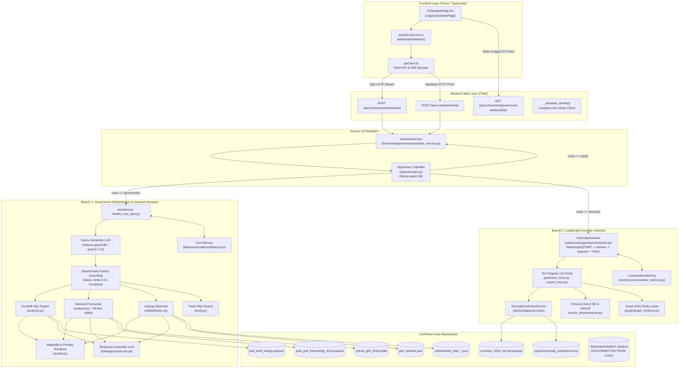
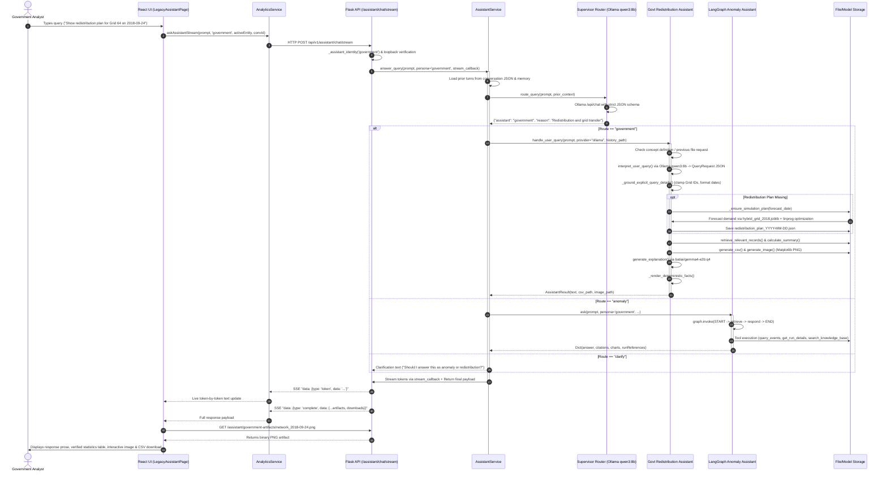

# GridVision Government Persona AI Assistant Architecture

## Executive Summary

The **Government Persona AI Assistant** in GridVision is a multi-tier, domain-grounded conversational intelligence system. It provides government grid operators and policy analysts with real-time insight into:
1. **Regional Grid Demand Forecasting & Historical Aggregations** across 53 coarse grid sectors in the 2018 dataset.
2. **Synthetic Energy Redistribution Planning** using constrained linear programming optimization (`scipy.optimize.linprog`) to balance grid surpluses and deficits while minimizing transmission losses.
3. **Power Quality & Grid Anomaly Investigation** through a LangGraph-orchestrated agent capable of inspecting localized spatial-temporal anomaly events, evaluating customer impact, executing detection runs, and performing semantic Vector RAG and Graph-RAG over IEEE and power systems standards.
4. **Renewable Energy & Web-Grounded Research** via Tavily web search.

The system employs a **Supervisor-Router Pattern** powered by local Ollama LLMs (`qwen3:8b`) to classify queries and dispatch them between specialized procedural and graph-based execution pipelines.

```
                              ┌──────────────────────────────────────────┐
                              │           React Frontend UI              │
                              │       (LegacyAssistantPage in            │
                              │        AiAssistantPage.tsx)              │
                              └────────────────────┬─────────────────────┘
                                                   │ POST /assistant/chat/stream
                                                   │ (SSE Streaming)
                                                   ▼
                              ┌──────────────────────────────────────────┐
                              │            Flask Backend API             │
                              │         (backend/app/api/v1/             │
                              │             assistant.py)                │
                              └────────────────────┬─────────────────────┘
                                                   │
                                                   ▼
                              ┌──────────────────────────────────────────┐
                              │            AssistantService              │
                              │     (backend/app/services/               │
                              │          assistant_service.py)           │
                              └────────────────────┬─────────────────────┘
                                                   │
                                                   ▼
                              ┌──────────────────────────────────────────┐
                              │       Supervisor Domain Router           │
                              │          (ai/govt/router.py)             │
                              │          Ollama `qwen3:8b`               │
                              └───────┬────────────┬─────────────┬───────┘
                                      │            │             │
                    route == "clarify"│            │             │route == "government"
                                      │            │             │
                                      ▼            │             ▼
                         ┌─────────────────┐       │   ┌──────────────────────────────────┐
                         │  Clarification  │       │   │ Government Redistribution        │
                         │    Response     │       │   │ & Demand Assistant               │
                         │ (Anomaly vs     │       │   │ (ai/Govt_interpretion+           │
                         │  Redistribution)│       │   │  redistribution_plan/assistant/) │
                         └─────────────────┘       │   │ - Two-Model LLM Pipeline         │
                                                   │   │ - DuckDB Parquet Analytics       │
                                                   │   │ - Hybrid ML Demand Predictor     │
                                                   │   │ - SciPy Linear Program Optimizer │
                                                   │   │ - Matplotlib & Pandas Renderers  │
                                                   │   │ - Tavily Web Research            │
                                                   │   └──────────────────────────────────┘
                                                   │
                                                   │route == "anomaly"
                                                   ▼
                                       ┌──────────────────────────────────┐
                                       │ LangGraph Anomaly Assistant      │
                                       │ (ai/anamoly/agents/              │
                                       │  orchestrator.py)                │
                                       │ - LangGraph StateGraph           │
                                       │ - 16 Registered Tools            │
                                       │ - AnomalyPredictionService       │
                                       │ - Chroma Vector RAG              │
                                       │ - Graph-RAG Entity Retriever     │
                                       │ - Export Tools (CSV/JSON)        │
                                       └──────────────────────────────────┘
```

---

## Architecture Overview

### High-Level Architecture Diagram



---

## Detailed End-to-End Query Execution Flow

### Execution Sequence Diagram



### Step-by-Step Step Flow

1. **User Interaction**:
   - The government analyst accesses `/ai-assistant` under the `government` persona.
   - The UI displays suggested prompt buttons for government tasks (redistribution, model forecasts, regional comparisons, reserve margin).
   - The user submits an input prompt.

2. **Frontend Dispatch**:
   - `frontend/src/pages/AiAssistantPage.tsx` delegates to `LegacyAssistantPage`.
   - `LegacyAssistantPage` calls `analyticsService.askAssistantStream(...)`.
   - `askAssistantStream` creates a persistent SSE connection via `fetch` to `/api/v1/assistant/chat/stream`.

3. **Backend Authentication & Request Validation**:
   - `backend/app/api/v1/assistant.py` receives the JSON payload.
   - Pydantic model `AssistantChatRequestModel` validates `prompt`, `persona`, `entity_id`, and `conversation_id`.
   - `_assistant_identity(...)` extracts session identity or sets development principal `local-government-assistant-test`.
   - `_reject_remote_local_government_test_request(...)` enforces that unauthenticated government access is strictly confined to loopback addresses (`127.0.0.1` / `::1`).

4. **Supervisor Query Routing**:
   - `AssistantService.answer_query(...)` detects `persona == "government"` and branches into `_answer_government_routed_query(...)`.
   - Reads conversation history from `ai/Govt_interpretion+redistribution_plan/data/conversations/{hash}.json` and `ConversationMemory`.
   - Calls `ai.govt.router.route_query(prompt, prior_context)`:
     - Grounded in `demo_queries.txt` (anomaly) and `QUERY_EXAMPLES.md` (redistribution).
     - Calls Ollama (`/api/chat` with model `qwen3:8b`, temperature `0`, strict JSON schema).
     - Returns `AssistantRoute(assistant='government' | 'anomaly' | 'clarify', reason=...)`.

5. **Sub-Assistant Execution**:
   - **Case A: Government Redistribution & Demand Assistant** (`ai.Govt_interpretion+redistribution_plan.assistant.assistant`):
     - Checks concept keywords (e.g., definitions of surplus/deficit) and returns deterministic glossary text if matched.
     - Invokes `interpret_user_query(...)` using `qwen3:8b` to generate a structured `QueryRequest` (Pydantic model in `schemas.py`).
     - Grounds dates, grid IDs, and timestamps against verified ranges.
     - If the target date's redistribution JSON does not exist, invokes `_ensure_simulation_plan(...)`:
       - Loads lag features from `gold_grid_forecasting_2018.parquet`.
       - Computes hourly demand with MLflow model `hybrid_grid_2018.joblib`.
       - Runs `redistribution.run_simulation(...)` via `scipy.optimize.linprog` across 53 grids with network edges from `grid_network.json`.
     - Queries DuckDB for historical aggregations and coverage validation.
     - Runs `render.generate_csv()` and `render.generate_image()` (Matplotlib network topology).
     - Invokes response model (`batiai/gemma4-e2b:q4`) to produce qualitative prose.
     - Appends deterministic numerical tables, interval counts, and energy totals.
   - **Case B: LangGraph Anomaly Assistant** (`ai.anamoly.agents.orchestrator.AnomalyAssistant`):
     - Executes a LangGraph `StateGraph(AssistantState)` through nodes `retrieve` -> `respond`.
     - Selects from 16 registered tools (`gridvision_tools.py`), such as `find_run_by_date`, `query_events`, `get_event_timeline`, `query_customer_impact`, `search_knowledge_base`, `retrieve_graph_context`, or `execute_anomaly_analysis`.
     - Interacts with `AnomalyPredictionService`, Chroma DB, and the Entity Graph.
   - **Case C: Renewable Energy Inquiries**:
     - Intercepted by `RenewableEnergyTools` (`ai/commercial/tools/renewable_energy.py`) using Tavily web search + peak demand context.

6. **Streaming & Artifact Presentation**:
   - The worker thread streams tokens to an in-memory queue.
   - The SSE generator yields `token` events to the client.
   - When complete, file paths are converted to API URLs:
     `/api/v1/assistant/government-artifacts/{filename}`
   - The client renders prose, downloads, artifact images, and SVG breakdown charts.

---

## Component & Integration Details

### 1. Frontend Layer

| File | Component / Function | Purpose |
| :--- | :--- | :--- |
| `frontend/src/pages/AiAssistantPage.tsx` | `AiAssistantPage` | Master switch component: delegates to `CommercialAssistantPage` (commercial), `ResidentialAssistantPage` (household), or `LegacyAssistantPage` (government/other). |
| `frontend/src/pages/AiAssistantPage.tsx` | `LegacyAssistantPage` | Renders Government UI, chat history, suggested prompt pills, SSE stream handler, SVG chart renderer, artifact image viewer, and CSV download links. |
| `frontend/src/services/analyticsService.ts` | `askAssistantStream()` | Establishes `fetch` SSE connection, decodes boundary-separated frames (`started`, `token`, `complete`, `error`), and accumulates streamed tokens. |
| `frontend/src/services/analyticsService.ts` | `askAssistant()` | Non-streaming POST client for synchronous assistant calls. |
| `frontend/src/services/apiClient.ts` | `apiClient` | Axios/fetch wrapper managing base URL (`/api/v1`) and auth headers. |

### 2. Backend API & Routing Layer

| File | Component / Function | Purpose |
| :--- | :--- | :--- |
| `backend/app/api/v1/assistant.py` | `POST /assistant/chat` | Synchronous REST endpoint for AI assistant queries. |
| `backend/app/api/v1/assistant.py` | `POST /assistant/chat/stream` | SSE streaming endpoint. Runs query in a background worker thread and streams chunked JSON events. |
| `backend/app/api/v1/assistant.py` | `GET /assistant/government-artifacts/<filename>` | Serves generated PNG charts and CSV data files from `ai/Govt_interpretion+redistribution_plan/assistant/output/`. Enforces file extension and path isolation checks. |
| `backend/app/api/v1/assistant.py` | `_assistant_identity()` | Resolves authenticated user or injects `local-government-assistant-test` if running locally in debug mode. |
| `backend/app/api/v1/assistant.py` | `_reject_remote_local_government_test_request()` | Security gate ensuring unauthenticated government dev access is restricted to loopback IP addresses (`127.0.0.1` / `::1`). |
| `backend/app/services/assistant_service.py` | `AssistantService.answer_query()` | Central facade. Dispatches government queries to `_answer_government_routed_query()`. |
| `backend/app/services/assistant_service.py` | `_answer_government_routed_query()` | Calls the supervisor router, resolves conversation context, executes the government assistant or anomaly orchestrator, and formats artifact URLs. |
| `ai/govt/router.py` | `route_query()` | Zero-shot supervisor router calling Ollama `qwen3:8b` with JSON schema constraint to classify intent as `government`, `anomaly`, or `clarify`. |

### 3. Government Redistribution & Demand Assistant Module

| File | Component / Function | Purpose |
| :--- | :--- | :--- |
| `ai/Govt_interpretion+redistribution_plan/assistant/assistant.py` | `handle_user_query()` | Primary entry point for government energy queries. Orchestrates interpretation, calculation, explanation, and file creation. |
| `ai/Govt_interpretion+redistribution_plan/assistant/assistant.py` | `interpret_user_query()` | Invokes Query Interpreter LLM (`qwen3:8b`) to parse natural language into `QueryRequest`. |
| `ai/Govt_interpretion+redistribution_plan/assistant/assistant.py` | `_ground_explicit_query_details()` | Deterministic verification: validates 53 grid IDs, dates (2018 only), timestamps, durations, and follow-up context. |
| `ai/Govt_interpretion+redistribution_plan/assistant/assistant.py` | `_ensure_simulation_plan()` | On-demand plan builder: if a 2018 redistribution plan is missing, runs hybrid demand forecasting and linear programming to generate it. |
| `ai/Govt_interpretion+redistribution_plan/assistant/schemas.py` | `QueryRequest` | Strict Pydantic model specifying 21 allowed intents, ISO dates, timestamps, grid ID arrays, and output formats (`text`, `csv`, `image`). |
| `ai/Govt_interpretion+redistribution_plan/assistant/providers.py` | `initialize_llm()` | LLM provider adapter supporting `OllamaProvider`, `GroqProvider`, `OpenRouterProvider`, and generic OpenAI-compatible endpoints with CA verification. |
| `ai/Govt_interpretion+redistribution_plan/assistant/analysis.py` | `historical_demand_summary()` | Executes DuckDB SQL queries over `grid_level_energy.parquet` to aggregate hourly demand, compute network means, and flag missing hours. |
| `ai/Govt_interpretion+redistribution_plan/assistant/analysis.py` | `forecast_demand_for_date()` | Loads 36 feature lags from `gold_grid_forecasting_2018.parquet` and predicts 24-hour demand using MLflow model `hybrid_grid_2018.joblib`. |
| `ai/Govt_interpretion+redistribution_plan/assistant/analysis.py` | `compare_historical_and_predicted_demand()` | Calculates statistical accuracy metrics: network and per-grid MAE, RMSE, MAPE, and WAPE. |
| `ai/Govt_interpretion+redistribution_plan/redistribution.py` | `run_simulation()` | Solves synthetic grid-to-grid energy redistribution using `scipy.optimize.linprog` across 53 grids with transmission loss minimization. |
| `ai/Govt_interpretion+redistribution_plan/assistant/render.py` | `generate_csv()` | Generates fixed-schema transfer CSVs (`timestamp, from_grid, to_grid, energy_sent_kwh, energy_received_kwh, energy_lost_kwh, ...`). |
| `ai/Govt_interpretion+redistribution_plan/assistant/render.py` | `generate_image()` | Generates Matplotlib network diagrams plotting grid centroids, color-coded node balances (green=surplus, red=deficit), and annotated transfer vectors. |
| `ai/Govt_interpretion+redistribution_plan/assistant/tavily.py` | `search_web()` | Queries Tavily search API for external regulatory or technical context. |

### 4. Anomaly Domain Assistant Module (LangGraph)

| File | Component / Function | Purpose |
| :--- | :--- | :--- |
| `ai/anamoly/agents/orchestrator.py` | `AnomalyAssistant` | LangGraph `StateGraph(AssistantState)` orchestrator compiled with `retrieve` and `respond` nodes. |
| `ai/anamoly/agents/orchestrator.py` | `ask()` | Executes the compiled StateGraph with persona, entity ID, principal, and conversation memory. |
| `ai/anamoly/tools/gridvision_tools.py` | `build_registry()` | Registers 16 domain tools restricted by persona (`GOVERNMENT_ONLY` vs `ALL_PERSONAS`). |
| `ai/anamoly/tools/gridvision_tools.py` | `list_available_runs`, `find_run_by_date`, `find_runs_for_period` | Discovers saved anomaly detection runs in `reports/anomaly_prediction/`. |
| `ai/anamoly/tools/gridvision_tools.py` | `get_event_details`, `query_events`, `get_event_timeline` | Queries localized spatial-temporal anomaly clusters and event chronologies. |
| `ai/anamoly/tools/gridvision_tools.py` | `query_customer_impact` | Evaluates customer-level telemetry deviations and severity metrics. |
| `ai/anamoly/tools/gridvision_tools.py` | `execute_anomaly_analysis` | Triggers a 1–7 day anomaly detection job using spatial clustering (H3 resolution 8, 5 km radius). |
| `ai/anamoly/tools/export_tools.py` | `export_events_csv`, `export_events_json` | Exports detected events to CSV or JSON formats. |
| `ai/anamoly/vector_store/retriever.py` | `KnowledgeRetriever.search()` | Vector RAG over indexed technical documents using Chroma DB and MiniLM embeddings. |
| `ai/anamoly/graph/graph_retriever.py` | `GraphRetriever.search_with_run()` | Graph-RAG linking anomaly events, affected customers, and geographic areas with technical reference documents. |
| `ai/anamoly/memory/conversation_memory.py` | `ConversationMemory` | Manages conversation state, turns, and recently inspected `run_id` and `event_id` keys. |

### 5. Data Retrieval Agent (Secondary Agent)

| File | Component / Function | Purpose |
| :--- | :--- | :--- |
| `data_retrieval_agent/agent.py` | `DataRetrievalAgent` | RBAC-governed LangGraph retrieval agent mounted at `/api/v1/data-retrieval-agent`. |
| `data_retrieval_agent/tools/registered.py` | `segmentation()` | Wraps `SegmentationService` to query customer cluster assignments, segment distributions, and regional summaries. |
| *Note* | **Disconnected from Chat UI** | Initialized in `backend/app/__init__.py`, but **not** wired into `AssistantService._answer_government_routed_query()`. |

---

## Data Sources & Integration Matrix

| Data Domain | Target Path / Artifact | Integration Type | Consuming Component | Status |
| :--- | :--- | :--- | :--- | :--- |
| **Historical 2018 Grid Demand** | `data/airflow/government/grid_level_energy.parquet` | SQL over DuckDB | `ai.assistant.analysis.historical_demand_summary` | Fully Integrated |
| **Grid Forecasting Features** | `data/airflow/government/gold_grid_forecasting_2018.parquet` | PyArrow / Pandas | `ai.assistant.analysis.forecast_demand_for_date` | Fully Integrated |
| **Trained Hybrid Forecast Model** | `mlflow/government/hybrid_grid_2018.joblib` | Joblib deserialization | `ai.assistant.analysis._load_hybrid_model` | Fully Integrated |
| **Grid Network Topology** | `ai/Govt_interpretion+redistribution_plan/data/grid_network.json` | JSON structure | `redistribution.py`, `render.py` | Fully Integrated |
| **Redistribution Simulations** | `ai/Govt_interpretion+redistribution_plan/output/redistribution_plan_*.json` | Validated JSON loader | `ai.assistant.data.load_simulation_json` | Fully Integrated |
| **Anomaly Normal Telemetry** | `data/anomaly_prediction/synthetic_2019_normal.parquet` | PyArrow / Pandas | `AnomalyPredictionService` | Fully Integrated |
| **Anomaly Run Outputs** | `reports/anomaly_prediction/application_runs/` | JSON files | `gridvision_tools.py` via `AnomalyPredictionService` | Fully Integrated |
| **Customer Segmentation** | `data/segmentation/*.parquet` (assignments, profiles, regions) | Parquet / PyArrow | `SegmentationService` via `data_retrieval_agent` | **Disconnected from Government Assistant** |
| **Technical Knowledge Base** | `ai/anamoly/knowledge_base/` | Chroma DB Vector Store | `KnowledgeRetriever` | Fully Integrated |
| **Web Research** | Tavily Web Search API | HTTP JSON API | `tavily.py`, `renewable_energy.py` | Fully Integrated |

---

## LLM Configuration & Model Matrix

The Government AI Assistant utilizes a multi-model architecture across its supervisor router and sub-assistants:

| Role | Default Model | Provider | Endpoint | Fallback / Alternative | Purpose |
| :--- | :--- | :--- | :--- | :--- | :--- |
| **Supervisor Router** | `qwen3:8b` | Ollama (Local) | `http://localhost:11434/api/chat` | Environment `GRIDVISION_ROUTER_MODEL` | Zero-shot intent classification (`government` vs `anomaly` vs `clarify`). |
| **Redistribution Query Interpreter** | `qwen3:8b` (or `qwen3:1.7b`) | Ollama / Groq / OpenRouter | `http://localhost:11434/api/chat` | `openai/gpt-oss-120b` (Groq/OpenRouter) | Extracts structured `QueryRequest` JSON from free-form user query. |
| **Redistribution Response Generator** | `batiai/gemma4-e2b:q4` | Ollama / Groq / OpenRouter | `http://localhost:11434/api/chat` | `openai/gpt-oss-20b` (Groq/OpenRouter) | Produces qualitative summary prose. Numerical facts are strictly appended by Python. |
| **Anomaly LangGraph LLM** | `qwen3:8b` | Ollama (Local) | `http://localhost:11434/api/chat` | Configured in `ai/anamoly/config` | Tool parameter extraction and synthesis for anomaly investigations. |

---

## Memory & State Management

GridVision implements three distinct memory mechanisms across the codebase:

1. **Government Redistribution Turn Memory** (`ai.assistant.assistant`):
   - Storage format: Hash-addressed JSON files in `ai/Govt_interpretion+redistribution_plan/data/conversations/{hash}.json`.
   - Key derivation: `SHA-256("{principal}:{conversation_id}")`.
   - Depth: Keeps the last 4 conversation turns (`HISTORY_TURNS = 4`).
   - Context retained: User questions, parsed `QueryRequest` parameters, last successful request (enabling follow-ups like "What about Grid 64?", "show the next 2 hours", "make it simpler"), and generated file paths (`last_generated_files` for PNG and CSV).

2. **Anomaly Agent Conversation Memory** (`ai.anamoly.memory.conversation_memory.py`):
   - In-memory turn store keyed by `(principal, conversation_id, persona)`.
   - Maintains `latest_structured_context`, saving active `run_id`, `event_id`, and evaluated time windows across turns.

3. **Session Repository** (`backend/app/infrastructure/repositories/conversation_memory_repository.py`):
   - SQLite-backed ChatGPT-style conversation CRUD (`/api/v1/assistant/conversations`).
   - **Limitation**: Currently restricted to `persona="residential"` and `HouseholdAuthService`; not accessible to Government persona sessions.

---

## Implemented vs Partially Implemented vs Missing Features

### Detailed Feature Status Matrix

| Capability / Feature | Implementation Status | Implementation Details & Location |
| :--- | :--- | :--- |
| **2018 Grid Demand Forecasting** | **Implemented** | `analysis.forecast_demand_for_date()` loads `gold_grid_forecasting_2018.parquet` and runs MLflow `hybrid_grid_2018.joblib`. |
| **Historical 2018 Demand Aggregations** | **Implemented** | `analysis.historical_demand_summary()` performs DuckDB SQL queries over `grid_level_energy.parquet` across 53 coarse grids. |
| **Historical vs Predicted Comparisons** | **Implemented** | `analysis.compare_historical_and_predicted_demand()` calculates MAE, RMSE, MAPE, and WAPE. |
| **Energy Redistribution Planning** | **Implemented** | `redistribution.py` solves constrained linear programming using `scipy.optimize.linprog` across 53 nodes with loss minimization. |
| **On-Demand Plan Generation** | **Implemented** | `assistant._ensure_simulation_plan()` automatically forecasts and runs `linprog` if a plan JSON is missing for a requested 2018 date. |
| **Direct-Neighbor Deficit Advice** | **Implemented** | `data.calculate_demand_solution()` suggests least-loss candidate transfers from adjacent surplus grids to deficit grids. |
| **Matplotlib Topology Visualization** | **Implemented** | `render.generate_image()` plots network nodes, surplus/deficit coloring, and annotated transfer vectors. |
| **Pandas Fixed-Schema CSV Export** | **Implemented** | `render.generate_csv()` produces fixed-column CSV tables with balance and transfer records. |
| **Supervisor Query Routing** | **Implemented** | `ai/govt/router.py` classifies user queries between anomaly, government, and clarification using Ollama `qwen3:8b`. |
| **LangGraph Anomaly Agent** | **Implemented** | `ai/anamoly/agents/orchestrator.py` runs a 2-node LangGraph StateGraph (`retrieve` -> `respond`) with 16 tools. |
| **Spatial-Temporal Anomaly Inspection** | **Implemented** | `gridvision_tools.py` provides tools to inspect runs, localized events, timelines, and customer impacts. |
| **Anomaly Model Execution** | **Implemented** | `execute_anomaly_analysis` tool executes 1–7 day anomaly detection jobs using H3 spatial clustering. |
| **Vector RAG (Anomaly Knowledge)** | **Implemented** | `ai/anamoly/vector_store/retriever.py` searches indexed power engineering standards using Chroma DB. |
| **Graph-RAG (Entity Expansion)** | **Implemented** | `ai/anamoly/graph/graph_retriever.py` joins run records to reference documents through extracted technical entities. |
| **Tavily Web Search Integration** | **Implemented** | `tavily.py` and `renewable_energy.py` query external web sources with live citations. |
| **SSE Streaming in UI** | **Implemented** | `/assistant/chat/stream` streams tokens to `LegacyAssistantPage` in React. |
| **Loopback Dev Mode Authentication** | **Partially Implemented** | `_reject_remote_local_government_test_request()` allows unauthenticated access on loopback, but full RBAC JWT validation for government users is bypassed in development. |
| **Conversation Session Management** | **Partially Implemented** | Government assistant uses file-based turn JSON; the RESTful `/assistant/conversations` CRUD endpoints are hardcoded to `persona="residential"`. |
| **Customer Segmentation Integration** | **Missing from Assistant** | `data/segmentation/*.parquet` and `SegmentationService` exist in the backend and `data_retrieval_agent`, but are **not connected** to `AssistantService` or `LegacyAssistantPage`. |
| **Live Telemetry & Multi-Year Data** | **Missing / By Design** | The assistant is strictly hardcoded to the 2018 calendar year. Queries requesting 2019+ or non-2018 dates are rejected by date guardrails. |
| **Unified Multi-Agent LangGraph Supervisor** | **Missing** | The government redistribution assistant is procedural Python; the anomaly assistant is a separate LangGraph; the data retrieval agent is a third LangGraph. They are not unified under a single LangGraph state machine. |

---

## Limitations and Potential Gaps

### 1. The Customer Segmentation Disconnect
- **Current State**: The GridVision platform contains extensive customer segmentation outputs in `data/segmentation/` (`consumer_assignments.parquet`, `cluster_profiles.parquet`, `region_summary_coarse.parquet`, `survey_priority.parquet`). Furthermore, `SegmentationService` provides full API access to these files, and `data_retrieval_agent` implements a `get_segmentation_results` tool.
- **The Gap**: In `backend/app/services/assistant_service.py`, `SegmentationService` is never injected into `AssistantService`. When a government user asks questions about customer segments, cluster load shapes, or survey prioritization in the UI, the supervisor router routes the query to either the redistribution assistant or the anomaly assistant, neither of which has tools or data loaders for segmentation.
- **Impact**: Government users cannot query consumer segmentation insights through the AI Assistant chat interface.

### 2. Architectural Silos (LangGraph vs Procedural)
- **Current State**: 
  - Anomaly Assistant (`ai/anamoly`) uses a compiled LangGraph `StateGraph`.
  - Data Retrieval Agent (`data_retrieval_agent`) uses a compiled LangGraph `StateGraph`.
  - Commercial Assistant (`ai/commercial`) uses a compiled LangGraph `StateGraph`.
  - Government Redistribution Assistant (`ai/Govt_interpretion+redistribution_plan`) uses a procedural Python orchestration pipeline in `assistant.py`.
- **The Gap**: The top-level `AssistantService` manually delegates queries using Python `if/else` checks and an external router script (`ai.govt.router.route_query`), rather than orchestrating agents as sub-graphs or tool nodes in a unified LangGraph multi-agent hierarchy.

### 3. Strict 2018 Temporal Boundary
- **Current State**: Date guardrails in `analysis.py` (`_validate_date_range`) explicitly enforce `start.year == 2018 and end.year == 2018`.
- **Impact**: Any prompt inquiring about 2019 or real-time dates immediately triggers an `EnergyAnalysisError("Only energy data from 2018 is supported.")`.

### 4. Conversation CRUD API Limitation
- **Current State**: The backend routes `/api/v1/assistant/conversations` (list, create, get, patch, delete) in `backend/app/api/v1/assistant.py` rely exclusively on `HouseholdAuthService.resolve_principal(request)` and pass `persona="residential"`.
- **Impact**: Government chat sessions cannot be named, listed, archived, or restored through the ChatGPT-style sidebar UI; government sessions rely solely on the backend's internal SHA-256 file-based history.

### 5. Dual Model Requirement in Local Ollama
- **Current State**: The Government Redistribution Assistant initializes two distinct local models: `qwen3:8b` (interpreter) and `batiai/gemma4-e2b:q4` (generator), while the router also invokes `qwen3:8b`.
- **Impact**: In resource-constrained environments, loading and swapping multiple large quantization models concurrently in Ollama memory can cause elevated latency or timeout errors (governed by the default 180s `OLLAMA_TIMEOUT_SECONDS`).

---

## File and Component Index

```
GridVision Repository
├── ai/
│   ├── Govt_interpretion+redistribution_plan/
│   │   ├── assistant/
│   │   │   ├── analysis.py          # DuckDB queries, ML forecasting, and accuracy metrics
│   │   │   ├── assistant.py         # Government query orchestration, interpretation, and facts
│   │   │   ├── data.py              # Simulation JSON validation and neighbor deficit solver
│   │   │   ├── providers.py         # LLM client abstractions (Ollama, Groq, OpenRouter)
│   │   │   ├── render.py            # Fixed-schema CSV and Matplotlib network map generation
│   │   │   ├── schemas.py           # Pydantic QueryRequest schema and intent definitions
│   │   │   └── tavily.py            # Tavily external search client
│   │   ├── paths.py                 # Central file and environment path resolution
│   │   └── redistribution.py        # SciPy linprog optimization pipeline
│   ├── anamoly/
│   │   ├── agents/
│   │   │   ├── orchestrator.py      # LangGraph StateGraph AnomalyAssistant
│   │   │   └── query_router.py      # Intent classifier for anomaly sub-paths
│   │   ├── graph/
│   │   │   └── graph_retriever.py   # Entity-based Graph-RAG retriever
│   │   ├── tools/
│   │   │   ├── gridvision_tools.py  # 16 domain tools for runs, events, and impact
│   │   │   └── export_tools.py      # CSV and JSON event export tools
│   │   └── vector_store/
│   │       └── retriever.py         # Chroma DB semantic vector search
│   └── govt/
│       └── router.py                # Local Ollama supervisor classifying anomaly vs government
├── backend/
│   └── app/
│       ├── api/v1/
│       │   └── assistant.py         # REST & SSE streaming routes (/assistant/chat, /stream)
│       └── services/
│           ├── assistant_service.py # AssistantService facade routing government queries
│           └── anomaly_prediction_service.py # Anomaly run and dataset management
├── data_retrieval_agent/            # Standalone LangGraph retrieval agent (has Segmentation tools)
└── frontend/
    └── src/
        ├── pages/
        │   └── AiAssistantPage.tsx  # React UI (LegacyAssistantPage for government)
        └── services/
            └── analyticsService.ts  # SSE streaming fetch client (askAssistantStream)
```

